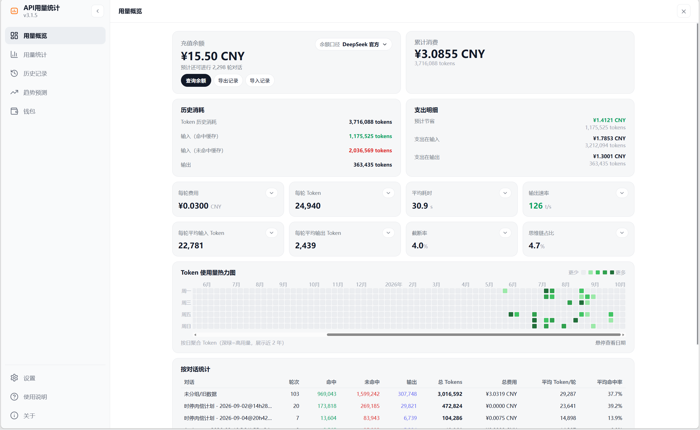
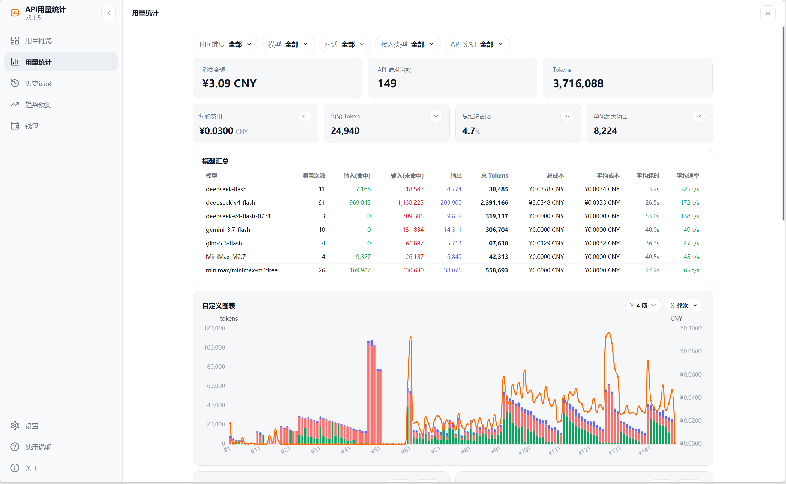
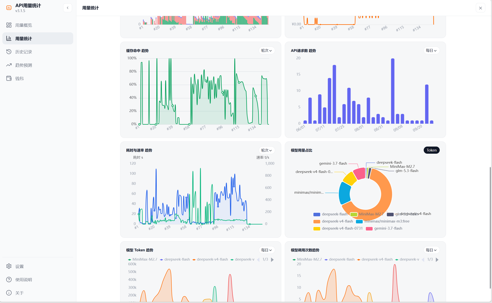
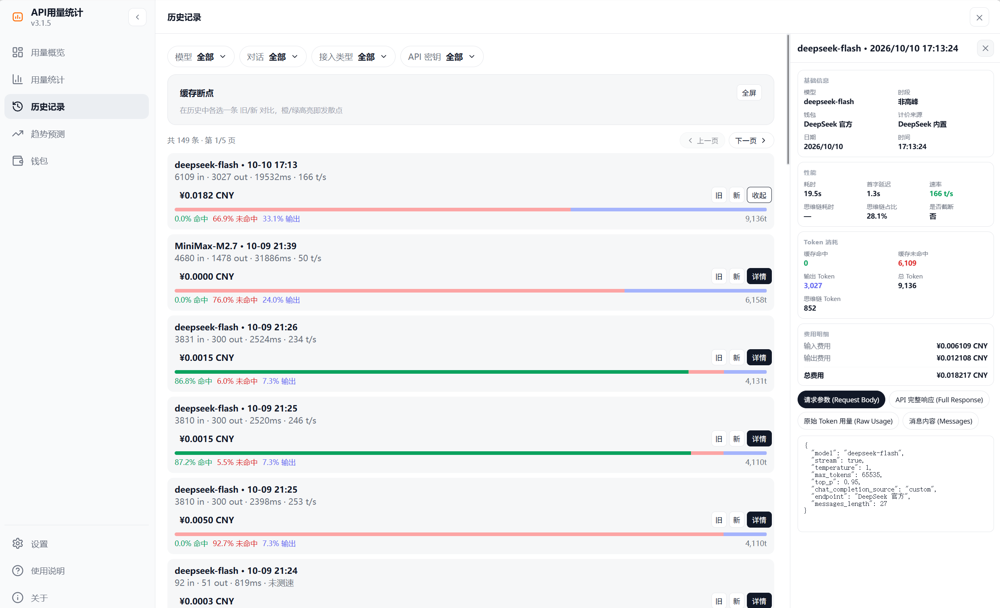
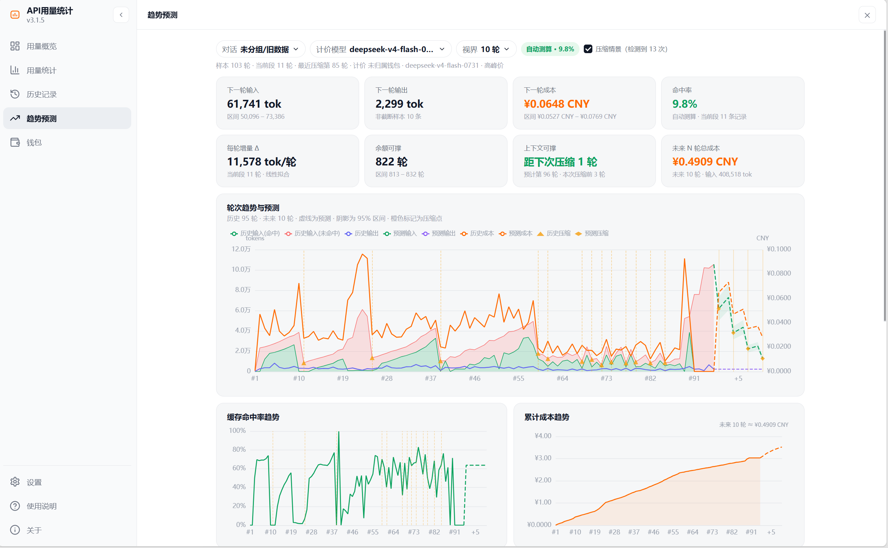

# API 用量统计

> SillyTavern 扩展：为 DeepSeek 与兼容接口记录每一次调用的 Token、费用、缓存与响应表现。

自动记录请求数据，提供**用量概览、多维统计、历史明细、趋势预测与多钱包管理**。纯前端本地运行，历史与设置默认只保存在本机。

[使用文档](https://janmk1453.github.io/Api-Usage/) · [安装](#安装) · [隐私声明](https://janmk1453.github.io/Api-Usage/#privacy) · [问题反馈](https://github.com/janmk1453/Api-Usage/issues)

## 界面预览

[](docs/images/overview.png)

<p align="center"><sub>用量概览 · 余额与消费、Token 构成、8 项指标、近两年热力图与按对话统计</sub></p>

<table width="100%">
  <tr>
    <td width="50%" align="center"><a href="docs/images/stats-summary.png"></a></td>
    <td width="50%" align="center"><a href="docs/images/stats-charts.png"></a></td>
  </tr>
  <tr>
    <td width="50%" align="center"><sub><b>用量统计 · 汇总</b><br>五维筛选、模型汇总与自定义图表</sub></td>
    <td width="50%" align="center"><sub><b>用量统计 · 图表</b><br>缓存命中、请求数、耗时/速率与模型占比</sub></td>
  </tr>
</table>

<table width="100%">
  <tr>
    <td width="50%" align="center"><a href="docs/images/history.png"></a></td>
    <td width="50%" align="center"><a href="docs/images/forecast.png"></a></td>
  </tr>
  <tr>
    <td width="50%" align="center"><sub><b>历史记录</b><br>逐次调用明细、缓存断点对比与四类原始数据详情</sub></td>
    <td width="50%" align="center"><sub><b>趋势预测</b><br>下一轮用量与成本、压缩点、余额与上下文可支撑轮数</sub></td>
  </tr>
</table>

## 核心功能

- **用量概览**：充值余额、累计消费、Token 构成、每轮均值、近两年热力图，以及按对话汇总的轮次、费用与命中率。
- **用量统计**：按时间、模型、对话、接入类型和 API 密钥五维筛选，查看消费、请求数、模型汇总，并用自定义图表与 6 张固定图表比较不同模型和时段的表现。
- **历史记录**：逐条查看 Token、费用、耗时、速率与缓存占比；详情窗口提供请求参数、完整响应、Raw 用量与消息内容，并支持新旧记录缓存断点对比。
- **趋势预测**：以单个对话为单位拟合输入、输出、成本与命中率，给出下一轮预估与 95% 区间、上下文压缩点、余额/上下文可支撑轮数、模型效率与能耗评分。
- **多钱包**：按接入地址自动建立钱包，分别管理余额、密钥、模型价格与峰谷规则；支持手工余额和 DeepSeek 官方余额自动校准。
- **计价与数据**：内置 DeepSeek 官方峰谷价与 2024–2026 中国法定节假日；支持 models.dev 价格同步、历史/钱包导入导出与 WebDAV 合并同步。

## 安装

需要 SillyTavern **1.11.0** 及以上。

1. 打开酒馆「扩展程序 → 安装扩展程序」，粘贴仓库地址后安装：

   ```text
   https://github.com/janmk1453/Api-Usage
   ```

2. 刷新页面，在魔法棒菜单中打开「API 用量统计」。
3. 正常对话即可自动记录；如已有旧版数据，可在概览页导入。

更新：在「关于 → 检查更新」选择 `main`（稳定）或 `dev`（测试），点击「立即更新」；也可在管理扩展程序中更新后刷新页面。

## 隐私与数据

本扩展是纯前端、本地运行的开源项目（MIT）。历史、设置、钱包配置保存在本机；钱包校准密钥与 WebDAV 密码仅经 XOR 混淆后本地保存，不参与导出与云同步。

默认开启的匿名使用统计只上报浏览器环境分桶、页面使用次数与渲染耗时分桶，**不含对话内容、模型名、密钥、余额、费用与接口地址**，可在「设置 → 匿名使用统计」随时关闭并重置匿名标识。完整字段、请求域名与保留期见[隐私声明](https://janmk1453.github.io/Api-Usage/#privacy)。

## 构建

```bash
npm install
npm run typecheck && npm test
npm run build && node --check index.js
npm run verify:ci
```

构建产物需一并提交：`index.js`、动态分包与 `style.css`。

## 致谢

部分实现参考了 [cone97218-alt/ds](https://github.com/cone97218-alt/ds)，在此致谢。

## 许可证

[MIT](LICENSE)
